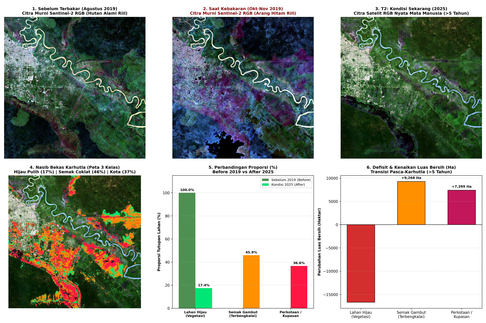
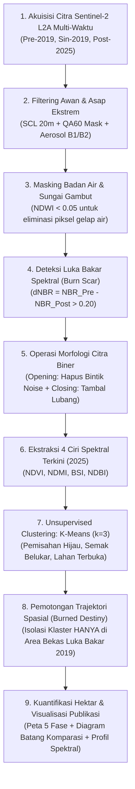

# 🛰️ Analisis Trajektori & Klasifikasi Tutupan Lahan Pasca-Karhutla Gambut Berbasis Sentinel-2 & K-Means PCD

[](https://www.python.org/)
[-emerald.svg)](https://sentinels.copernicus.eu/)
[](https://earthengine.google.com/)
[](https://www.polban.ac.id/)
[](LICENSE)

---

## 👥 Tim Peneliti (Kelompok 3B)
Proyek Tugas Besar Mata Kuliah **Pengolahan Citra Digital (PCD)**  
**Program Studi D4 Teknik Informatika — Jurusan Teknik Komputer dan Informatika**  
**Politeknik Negeri Bandung (POLBAN)**

| No | Nama Mahasiswa | NIM | Peran Utama |
|:--:|:---|:---:|:---|
| 1 | **Idotoho Reimon Simajuntak** | `241524047` | Ekstraksi Ciri Spektral (NDVI, NDMI, BSI) & Pemodelan Klasterisasi |
| 2 | **Ihsan Fauzi** | `241524048` | Arsitektur GEE Script, Filtering Awan/Aerosol & Integrasi Pipeline Python |
| 3 | **Muhammad Azzar MannalHadi** | `241524051` | Morfologi Citra (Opening/Closing), Validasi Geometri & Analisis Kuantitatif |

---

## 📌 1. Latar Belakang & Urgensi Masalah

Bencana Kebakaran Hutan dan Lahan (**Karhutla**) tahun 2019 di lahan gambut Kalimantan Tengah (Palangka Raya – Pulang Pisau) merupakan salah satu peristiwa kebakaran biosfer tropis terparah dalam dekade terakhir. Karhutla gambut merusak cadangan karbon bawah tanah dan melepaskan emisi kabut asap beracun lintas batas negara.

Setelah rentang waktu **lebih dari 5 tahun (>5 tahun, 2019 s/d 2025)**, muncul pertanyaan kritis dalam riset penginderaan jauh dan Pengolahan Citra Digital:
> **"Bagaimanakah nasib dan kondisi tutupan lahan pada bekas luka bakar tersebut saat ini? Apakah pulih secara suksesi alami menjadi kanopi hijau lebat, terbengkalai menjadi semak belukar kering yang rawan terbakar ulang, atau beralih fungsi menjadi lahan kupasan dan aktivitas antropogenik?"**

Proyek ini menghadirkan pipeline komputasi citra digital mutakhir yang menggabungkan kekuatan pemrosesan awan **Google Earth Engine (GEE)** dengan algoritma saintifik lokal **Python (NumPy, Tifffile, Matplotlib, Scikit-Learn)** untuk memetakan dan mengukur kuantitas defisit ekologis tersebut secara presisi pada resolusi spasial **10 meter**.

---

## 🖼️ 2. Hasil Visualisasi Kronologis & Komparasi Proporsi (5 Fase + 1 Diagram)

Berikut adalah komparasi visual komprehensif dari rekonstruksi kronologis multi-waktu sebelum kebakaran (2019), saat kebakaran (2019), kondisi satelit terkini (2025), peta tematik hasil klasifikasi, batas morfologi luka bakar, serta diagram evaluasi kuantitatif luasan lahan:



---

## 📊 3. Temuan Kuantitatif Utama (Evaluasi Defisit Ekologis)

Berdasarkan komputasi piksel riil resolusi 10 meter (1 piksel = $10\,\text{m} \times 10\,\text{m} = 100\,\text{m}^2 = 0.01\,\text{Hektar}$), diperoleh temuan spasial kuantitatif sebagai berikut:

| No | Kategori Tutupan Lahan Pasca-Karhutla | Jumlah Piksel | Luas Area (Hektar) | Proporsi (%) | Implikasi Ekologis & Kebijakan |
|:--:|:---|:---:|:---:|:---:|:---|
| 1 | **Kelas 1: Hijau Pulih (Suksesi Alami)** | `352,017` | **3,520.17 Ha** | **17.44%** | Regenerasi kanopi vegetasi berhasil terjadi secara alami. |
| 2 | **Kelas 2: Semak Belukar Terbengkalai** | `926,821` | **9,268.21 Ha** | **45.91%** | **Zona Kritis:** Ditumbuhi pakis/semak kering (*fuel load* tinggi, rentan siklus karhutla berulang). |
| 3 | **Kelas 3: Lahan Terbuka / Kupasan / Kota** | `739,996` | **7,399.96 Ha** | **36.65%** | Lahan gambut gundul/terbuka dan terindikasi konversi antropogenik. |
| **TOTAL** | **Seluruh Area Bekas Luka Bakar (2019)** | **2,018,834** | **20,188.34 Ha** | **100.00%** | **Defisit Tutupan Pohon Alami: 82.56% (16,668.17 Ha)!** |

> ⚠️ **Insight Kunci:**  
> Sebanyak **82.56%** lahan bekas karhutla **belum pulih menjadi kanopi hutan lebat** setelah 5 tahun lebih. Dominasi semak belukar seluas **9,268 Ha (45.91%)** membuktikan teori *fire-recurrence trap* (Vetrita & Cochrane, 2020), di mana biomassa semak pakis kering menjadi pemicu kebakaran berulang saat musim kemarau ekstrem (El Niño).

---

## 🔬 4. Alur Pipeline Pengolahan Citra Digital (PCD Methodology)

Pipeline penelitian ini dirancang secara sistematis dengan tahapan sebagai berikut:



### Landasan Matematis Algoritma PCD:

1. **Normalized Burn Ratio (NBR) & Differenced NBR (dNBR):**
   $$\text{NBR} = \frac{\text{NIR} - \text{SWIR}_2}{\text{NIR} + \text{SWIR}_2} = \frac{\text{B8} - \text{B12}}{\text{B8} + \text{B12}}$$
   $$\Delta\text{NBR} = \text{NBR}_{\text{pre}} - \text{NBR}_{\text{post}}$$
   *Piksel dengan $\Delta\text{NBR} > 0.20$ diklasifikasikan sebagai area luka bakar api nyata.*

2. **Normalized Difference Water Index (NDWI) untuk Masking Air Gambut:**
   $$\text{NDWI} = \frac{\text{Green} - \text{NIR}}{\text{Green} + \text{NIR}} = \frac{\text{B3} - \text{B8}}{\text{B3} + \text{B8}}$$

3. **Operasi Morfologi Citra (Mathematical Morphology):**
   - **Opening ($A \circ B$):** Erosi diikuti Dilasi untuk mengeliminasi false positive (bintik derau soliter akibat bayangan awan):
     $$A \circ B = (A \ominus B) \oplus B$$
   - **Closing ($A \bullet B$):** Dilasi diikuti Erosi untuk menambal rongga dan menyatukan klaster bekas kebakaran:
     $$A \bullet B = (A \oplus B) \ominus B$$

4. **Ekstraksi Ciri Spektral Lanjutan (Tahun 2025):**
   - **NDVI (Kerapatan Klorofil Vegetasi):**
     $$\text{NDVI} = \frac{\text{B8} - \text{B4}}{\text{B8} + \text{B4}}$$
   - **NDMI (Kandungan Kadar Air Tajuk/Canopy Moisture):**
     $$\text{NDMI} = \frac{\text{B8} - \text{B11}}{\text{B8} + \text{B11}}$$
   - **BSI (Bare Soil Index / Keterbukaan Tanah Kering):**
     $$\text{BSI} = \frac{(\text{B11} + \text{B4}) - (\text{B8} + \text{B2})}{(\text{B11} + \text{B4}) + (\text{B8} + \text{B2})}$$

5. **K-Means Clustering:**
   Meminimalkan fungsi inersia kuadrat jarak Euclidean piksel ke centroid klaster terdekat:
   $$J = \sum_{j=1}^{k} \sum_{i \in S_j} \|\mathbf{x}_i - \boldsymbol{\mu}_j\|^2$$

---

## 📁 5. Struktur Berkas Repositori

```text
Klasifikasi-Citra-Satelit/
├── .gitignore                      # Mengabaikan cache dan file GeoTIFF besar (>50MB)
├── README.md                       # Dokumentasi lengkap proyek tugas besar PCD
├── requirements.txt                # Daftar dependensi Python (tifffile, numpy, matplotlib, dll)
├── script_gee.js                   # Source code lengkap Google Earth Engine (JavaScript)
├── get_data.py                     # Skrip validasi dataset lokal & panduan ekspor GEE
├── analisis_karhutla.py            # Skrip CLI pemrosesan lokal citra satelit & generate grafik
├── analisis_karhutla.ipynb         # Jupyter Notebook interaktif (Laporan & Eksperimen PCD)
├── data/
│   ├── Hasil_Klaster_3Kelas_Karhutla.tif  # Raster hasil klasifikasi 3 kelas (347 KB)
│   └── Citra_Sentinel2_Kalteng_2025.tif   # [Opsional] Citra mentah 6 band Sentinel-2 (95.5 MB)
└── results/
    ├── komparasi_kronologis_dan_proporsi.png  # Visualisasi utama 5 panel citra + 1 diagram batang
    └── hasil_analisis_pcd_karhutla.png        # Plot visual komplementer PCD
```

---

## 🚀 6. Panduan Menjalankan Proyek (Quick Start)

### Persyaratan Awal:
- Python 3.9 atau versi yang lebih baru
- Akun [Google Earth Engine](https://code.earthengine.google.com/) (aktif)

### Langkah 1: Kloning Repositori
```bash
git clone https://github.com/ihsanfauzi/Klasifikasi-Citra-Satelit.git
cd Klasifikasi-Citra-Satelit
```

### Langkah 2: Buat Lingkungan Virtual & Pasang Dependensi
```bash
python -m venv venv
# Windows:
venv\Scripts\activate
# Linux/macOS:
source venv/bin/activate

pip install -r requirements.txt
```

### Langkah 3: Verifikasi Ketersediaan Dataset
Jalankan modul pemeriksa integritas data:
```bash
python get_data.py
```

### Langkah 4: Jalankan Analisis via CLI Python
Skrip ini akan memproses citra GeoTIFF di folder `data/` dan memperbarui grafik di folder `results/`:
```bash
python analisis_karhutla.py
```

### Langkah 5: Eksplorasi Interaktif via Jupyter Notebook
Buka dan jalankan seluruh cell di notebook:
```bash
jupyter lab analisis_karhutla.ipynb
# Atau:
jupyter notebook analisis_karhutla.ipynb
```

---

## 🌐 7. Eksekusi Script di Google Earth Engine (GEE)

Untuk mengeksplorasi antarmuka peta interaktif GEE (*Interactive Map, Swipe Comparison Slider, & Pixel Inspector*):
1. Buka [Google Earth Engine Code Editor](https://code.earthengine.google.com/).
2. Buat script baru, salin seluruh isi berkas [`script_gee.js`](script_gee.js), dan tempelkan ke editor.
3. Klik tombol **Run**.
4. Peta interaktif akan memuat 3 lapisan multi-fase, tirai geser (*swipe curtain*), dan panel inspektor nilai piksel spektral.
5. Pada panel **Tasks** di sebelah kanan atas, Anda dapat mengekspor berkas GeoTIFF resolusi penuh ke Google Drive.

---

## 📚 8. Referensi Jurnal Acuan Utama & Komparasi Metodologi (Scopus Q1 / Open Access)

Penelitian ini memadukan **3 jurnal acuan utama (100% Open Access & DOI aktif)** yang masing-masing menjadi landasan langsung bagi tahapan di dalam [`script_gee.js`](script_gee.js):

### A. 3 Jurnal Acuan Utama
1. **Abujayyab, S. K. M. (2026).** *An Interactive GEE Application for Burned Area Mapping Using $\Delta$NBR Thresholding and Machine Learning: A Case Study from the 2025 Bilecik–Sakarya Wildfire, Türkiye.* **International Journal of Engineering and Geosciences**, 11(3), 614–628.
   - **DOI:** [https://doi.org/10.26833/ijeg.1798639](https://doi.org/10.26833/ijeg.1798639) | **Akses PDF:** [DergiPark IJEG (Open Access)](https://dergipark.org.tr/en/pub/ijeg/issue/87711)
2. **Stavrakoudis, D., Katagis, T., Minakou, C., & Gitas, I. Z. (2020).** *Automated Burned Scar Mapping Using Sentinel-2 Imagery.* **Journal of Geographic Information System**, 12(3), 221–240.
   - **DOI:** [https://doi.org/10.4236/jgis.2020.123014](https://doi.org/10.4236/jgis.2020.123014) | **Akses PDF:** [SCIRP JGIS (Open Access)](https://www.scirp.org/journal/paperinformation?paperid=100788)
3. **Vetrita, Y., & Cochrane, M. A. (2020).** *Fire Frequency and Related Land-Use and Land-Cover Changes in Indonesia's Peatlands.* **Remote Sensing**, 12(1), 5. (Scopus Q1).
   - **DOI:** [https://doi.org/10.3390/rs12010005](https://doi.org/10.3390/rs12010005) | **Akses PDF:** [MDPI Remote Sensing (Open Access)](https://www.mdpi.com/2072-4292/12/1/5)

### B. Matriks Komparasi Metodologi Jurnal Acuan vs [`script_gee.js`](script_gee.js)

| Jurnal Acuan Utama | Persamaan Alur & Metode dengan [`script_gee.js`](script_gee.js) | Perbedaan Metode / Domain & Kontribusi Unik Kita |
|:---|:---|:---|
| **1. Abujayyab (2026)**<br/>*(Acuan GEE, $\Delta\text{NBR}$ & K-Means)* | • Akuisisi komposit Pre-Fire & Post-Fire **Sentinel-2 L2A** di **GEE**<br/>• Cloud masking (`QA60`) + **NDWI masking** badan air<br/>• Segmentasi luka bakar dengan **ambang batas persis $\Delta\text{NBR} > 0.20$**<br/>• Menggunakan `ee.Clusterer.wekaKMeans` & membangun **Interactive GEE UI App** | • **Beda Tahap K-Means:** Jurnal memakai K-Means pada $\Delta\text{NBR}$ hanya untuk memetakan luka bakar saat kejadian (T1), sedangkan script kita memakai $\Delta\text{NBR} > 0.20$ untuk batas luka bakar 2019 (T1) lalu menjalankan **K-Means ($k=3$) pada 4 indeks spektral 2025 (NDVI, NDMI, BSI, NDBI)** untuk melacak nasib pemulihan lahan (>5 tahun).<br/>• **Beda Domain:** Hutan Mediterania Turki vs Lahan Gambut Kalimantan Tengah. |
| **2. Stavrakoudis et al. (2020)**<br/>*(Acuan Morfologi PCD)* | • Menggunakan pasangan citra **Sentinel-2 Pre-Fire & Post-Fire** dan indeks **dNBR**<br/>• Menerapkan **Operasi Morfologi Matematis (*Opening* & *Closing*)** pasca-segmentasi untuk membuang *salt-and-pepper noise* (bintik piksel palsu) | • **Beda Klasifikasi:** Jurnal menggunakan aturan empiris + SVM.<br/>• **Kebaruan Kita:** Menguji sensitivitas multi-skala struktur elemen morfologi (`R=1.0`, `R=1.5`, `R=2.5`) di GEE dan mengombinasikan **$\text{NDWI} < 0.05$** khusus untuk mengeliminasi sungai air hitam (*blackwater tannin river*) khas rawa gambut. |
| **3. Vetrita & Cochrane (2020)**<br/>*(Acuan Domain Gambut Kalteng)* | • Lokasi studi **sama persis**: Lahan gambut Kalimantan Tengah (Palangka Raya – Pulang Pisau / Eks-PLG)<br/>• Mengkaji transisi hutan rawa gambut pasca-terbakar menjadi **semak belukar/pakis (*fern/shrub*)** yang memicu *fire-recurrence trap* | • **Beda Sensor & Periode:** Menggunakan sensor resolusi menengah-rendah (Landsat 30m & MODIS 250m) pada periode 2001–2018.<br/>• **Kebaruan Kita:** Membuktikan fenomena suksesi terhambat tersebut menggunakan **Sentinel-2 (10m)** pasca-Karhutla besar **2019 hingga 2025 (>5 tahun)**. |

---

## 📝 9. Checklist Progress Penyusunan Paper Ilmiah (Target: SINTA 2 / Scopus Conference)

Bagian ini melacak kesiapan komponen kode, eksperimen, validasi, dan penulisan naskah publikasi ilmiah:

### Tahap 1: Pipeline Kode & Eksperimen Pengolahan Citra Digital (PCD)
- [x] Akuisisi citra multi-temporal Sentinel-2 L2A 3 Fase di GEE (`T0: Pre-2019`, `T1: Pasca-Bakar 2019`, `T2: Evaluasi 2024–2025`).
- [x] Penapisan berlapis kabut asap & awan (`SCL` 20m + Bitwise `QA60` + Filter Aerosol `B1 < 1400` & `B2 < 1650`).
- [x] Masking badan air hitam rawa gambut menggunakan ambang batas $\text{NDWI} < 0.05$.
- [x] Deteksi area luka bakar (*burn scar*) menggunakan $\Delta\text{NBR} > 0.20$.
- [x] Pemurnian geometri poligon luka bakar dengan Operasi Morfologi Matematis (*Opening* & *Closing* multi-skala `R=1.0`, `R=1.5`, `R=2.5` + *Majority Filter* $3 \times 3$).
- [x] Ekstraksi 4 indeks spektral biofisik kondisi terkini (NDVI, NDMI, BSI, NDBI) & normalisasi *Min-Max* (`unitScale`).
- [x] Klasterisasi *Unsupervised K-Means* ($k=3$) dengan pengurutan label otomatis (*auto-sorting centroid NDVI*) & isolasi khusus di dalam area luka bakar 2019 (`burnedDestiny3`).
- [x] Pembuatan *Interactive GEE App* (Triple-View Synchronized Maps, Master Swipe Curtain 5 Mode, & Klik Inspektor Diagnosis Piksel).
- [x] Pipeline analisis lokal Python ([`analisis_karhutla.py`](analisis_karhutla.py) & [`analisis_karhutla.ipynb`](analisis_karhutla.ipynb)) dan generasi grafik komparasi 6-panel resolusi tinggi.

### Tahap 2: Kelengkapan Data & Validasi Ilmiah (To-Do untuk Paper)
- [ ] **Unduh Citra Riil 2019 (`Before` & `PasBakar`):** Jalankan *task export* `Citra_Sentinel2_Kalteng_2019_Before` dan `Citra_Sentinel2_Kalteng_2019_PasBakar` dari tab `Tasks` GEE ke folder `data/`, lalu jalankan ulang [`analisis_karhutla.py`](analisis_karhutla.py) agar Panel 1 & 2 pada gambar publikasi menampilkan RGB 2019 murni (bukan *fallback* komposit CIR/SWIR 2025).
- [ ] **Tabel Ablasi Morfologi (*Sensitivity Analysis*):** Catat angka hektar dari konsol GEE untuk `A1_Luka_Bakar_Kasar_Ha` (tanpa morfologi) vs `A2` (`R=1.0`), `A3` (`R=1.5`), dan `A4` (`R=2.5`) serta `A5_Noise_Dieliminasi_Ha` sebagai tabel bukti efektivitas operasi morfologi di bab *Results*.
- [ ] **Tabel Statistik Spektral Centroid Klaster:** Salin nilai rata-rata dan standar deviasi `NDVI`, `NDMI`, `BSI`, dan `NDBI` untuk masing-masing dari 3 kelas klaster (dari output GEE Console / Notebook) ke dalam tabel naskah paper.
- [ ] **Validasi Akurasi (*Ground-Truth Validation*):**
  - [ ] Gunakan ekspor `GroundTruth_Hotspot_NASA_FIRMS_2019.csv` untuk menghitung persentase kesesuaian spasial antara poligon $\Delta\text{NBR} > 0.20$ terhadap titik panas aktif NASA FIRMS 2019.
  - [ ] Ambil sampel titik acak (*stratified random sampling*, misal 100–150 titik) pada citra resolusi tinggi Google Earth / komposit SWIR 2025 untuk menyusun **Confusion Matrix**, **Overall Accuracy (OA)**, dan **Kappa Coefficient** hasil klasifikasi 3 kelas K-Means.
- [ ] **Evaluasi K-Means (*Cluster Validity Index*):** Tambahkan perhitungan *Silhouette Score* atau *Elbow Method* ($k=2, 3, 4, 5$) di notebook Python untuk menjustifikasi secara matematis mengapa pemilihan $k=3$ adalah jumlah klaster paling optimal.

### Tahap 3: Penulisan Naskah Paper (IMRaD Structure)
- [ ] **Judul & Abstrak:** Rumuskan masalah, metode ($\Delta\text{NBR}$ + Morfologi + Multi-Indeks K-Means), temuan utama (defisit pohon 82.56%, dominasi semak 45.91%), dan implikasi mitigasi karhutla.
- [ ] **1. Introduction:** Latar belakang Karhutla gambut Kalteng 2019, bahaya siklus kebakaran berulang (*fire-recurrence trap*), *research gap* (studi terdahulu berhenti di pemetaan luas bakar T1 atau memakai sensor resolusi rendah), dan kontribusi penelitian.
- [ ] **2. Study Area & Data:** Peta lokasi studi (Palangka Raya – Pulang Pisau), spesifikasi akuisisi Sentinel-2 L2A 3 fase waktu, dan alasan pemilihan *Golden Window* pasca-hujan pertama (15 Okt – 28 Nov 2019).
- [ ] **3. Methodology:** Diagram alir penelitian, rumus matematis (NDWI, NBR, $\Delta\text{NBR}$, Opening/Closing, NDVI, NDMI, BSI, NDBI, objektif K-Means), dan skema *auto-sorting* klaster.
- [ ] **4. Results:** Peta visual 3 fase, hasil reduksi *salt-and-pepper noise* oleh morfologi, profil pemisahan spektral 4 indeks, distribusi luasan hektar & persentase 3 kelas nasib lahan (per sampel 10x10 km dan rekapitulasi kabupaten).
- [ ] **5. Discussion:** Mengaitkan temuan 45.91% semak belukar kering (NDMI rendah, BSI tinggi) dengan literatur suksesi gambut terhambat (Vetrita & Cochrane, 2020; Hoscilo et al., 2011; Volkova et al., 2021) serta keterbatasan studi.
- [ ] **6. Conclusion:** Kesimpulan kuantitatif dan rekomendasi prioritas restorasi hidrologis (sekat kanal & revegetasi) pada zona kelas 2 (Semak Kritis).
- [ ] **Formatting & Proofreading:** Penyesuaian *template* LaTeX/Word sesuai target jurnal/konferensi, pengecekan sitasi menggunakan Mendeley/Zotero (dengan DOI terverifikasi di atas).

---

## 📜 Lisensi
Proyek ini dilisensikan di bawah lisensi [MIT License](LICENSE). Seluruh kode dan dataset terbuka untuk keperluan riset akademis dan edukasi.

